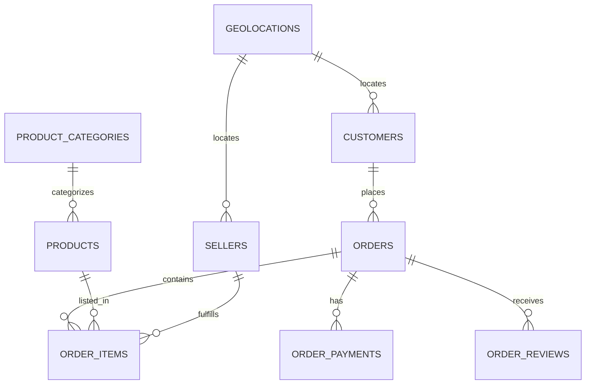

# Tài liệu Cơ sở dữ liệu (Database Documentation)

Tài liệu mô tả thiết kế SQLite database tại [`scripts/database/olist.db`](../scripts/database/olist.db) của dự án phân tích thương mại điện tử Olist Brazil (2016–2018).

---

## 1. Kiến trúc 3 tầng

```
data/processed/clean_*.csv
        ↓  [scripts/database/build_db.py]
  Staging Tables (stg_*)       ← Import nhanh từ CSV, không ràng buộc
        ↓  [sql/02_load_data.sql]
  Relational Tables (3NF)      ← Chuẩn hóa, FK constraints, Indexes
        ↓  [sql/03_queries.sql]
  Analytical Views + Q1-Q8     ← View phục vụ phân tích và truy vấn kết quả
```

Luồng build gồm 5 bước:

1. **Tạo schema:** tạo staging tables, bảng quan hệ và index.
2. **Nạp CSV:** đọc các file đã làm sạch trong `data/processed/` vào `stg_*`.
3. **Chuyển dữ liệu:** `02_load_data.sql` lọc/chuyển dữ liệu từ staging sang các bảng quan hệ.
4. **Tạo view:** tạo các view được định nghĩa trong `03_queries.sql`.
5. **Kiểm tra:** đếm bản ghi và kiểm tra một số điều kiện toàn vẹn.

`build_db.py` tự chạy toàn bộ quy trình trên. Các câu truy vấn phân tích Q1-Q8 trong `03_queries.sql` không chạy trong lúc build; chạy file SQL riêng hoặc truy vấn từ notebook để xem kết quả.

---

## 2. Sơ đồ ERD



Sơ đồ thể hiện đủ 9 bảng quan hệ. Đọc từ trên xuống: khách hàng đặt đơn; đơn có thể gồm nhiều mặt hàng, khoản thanh toán và đánh giá; mỗi dòng mặt hàng gắn với một sản phẩm và người bán. Sản phẩm có thể thuộc một danh mục; khách hàng và người bán có thể tham chiếu địa điểm qua mã ZIP.

### Ký hiệu và loại quan hệ

- `||` nghĩa là **một**; `o{` nghĩa là **không hoặc nhiều**. Ví dụ `CUSTOMERS ||--o{ ORDERS` đọc là một khách hàng có thể có 0 hoặc nhiều đơn; mỗi đơn thuộc về đúng một khách hàng.
- **1–N:** `CUSTOMERS–ORDERS`, `ORDERS–ORDER_ITEMS`, `ORDERS–ORDER_PAYMENTS`, `ORDERS–ORDER_REVIEWS`, `PRODUCTS–ORDER_ITEMS`, `SELLERS–ORDER_ITEMS`, `PRODUCT_CATEGORIES–PRODUCTS`, `GEOLOCATIONS–CUSTOMERS` và `GEOLOCATIONS–SELLERS`.
- **N–N:** `ORDERS–PRODUCTS` là quan hệ nhiều-nhiều về mặt nghiệp vụ: một đơn có nhiều sản phẩm, và một sản phẩm có thể xuất hiện ở nhiều đơn. Bảng trung gian `ORDER_ITEMS` biểu diễn quan hệ này. `ORDERS–SELLERS` cũng là nhiều-nhiều qua `ORDER_ITEMS`.
- **1–1:** Không có quan hệ 1–1 được ràng buộc trực tiếp trong schema hiện tại.

### Quan hệ giữa các bảng (diễn giải bằng lời)

- **CUSTOMERS → ORDERS:** Một khách hàng có thể đặt nhiều đơn. Nối bằng `customer_id`.
- **ORDERS → ORDER_ITEMS:** Một đơn có thể gồm nhiều dòng mặt hàng; mỗi dòng là một sản phẩm trong đơn. Nối bằng `order_id`.
- **ORDERS → ORDER_PAYMENTS:** Một đơn có thể có một hoặc nhiều bản ghi thanh toán. Nối bằng `order_id`.
- **ORDERS → ORDER_REVIEWS:** Một đơn có thể chưa có review hoặc có một/nhiều review. Nối bằng `order_id`.
- **ORDER_ITEMS → PRODUCTS:** Mỗi dòng mặt hàng tham chiếu sản phẩm tương ứng. Nối bằng `product_id`; một sản phẩm có thể xuất hiện trong nhiều dòng đơn hàng.
- **ORDER_ITEMS → SELLERS:** Mỗi dòng mặt hàng gắn với người bán cung cấp sản phẩm đó. Nối bằng `seller_id`; một người bán có thể xuất hiện ở nhiều dòng mặt hàng.
- **PRODUCTS → PRODUCT_CATEGORIES:** Sản phẩm có thể gắn với một danh mục; một danh mục có thể có nhiều sản phẩm. Nối bằng `product_category_name`.
- **CUSTOMERS/SELLERS → GEOLOCATIONS:** Mã ZIP của khách hàng hoặc người bán tham chiếu đến địa điểm tương ứng. Nối `customer_zip_code_prefix` hoặc `seller_zip_code_prefix` với `geolocations.zip_code_prefix`. Nhiều khách hàng/người bán có thể cùng tham chiếu một mã ZIP.

Lưu ý: schema cho phép một `customer_id` có nhiều đơn, nhưng trong dataset Olist `customer_id` thường đại diện cho khách gắn với một đơn cụ thể. Dùng `customer_unique_id` để nhận diện cùng một người qua nhiều lần mua. Một đơn có thể có nhiều dòng `ORDER_ITEMS`, vì vậy khi nối thêm dữ liệu thanh toán hoặc review cần chú ý tránh đếm lặp số liệu cấp đơn.

---

## 3. Mô tả các bảng

### Bảng 1: `customers`
| Cột | Kiểu | Khóa | Mô tả |
|---|---|---|---|
| `customer_id` | TEXT | **PK** | Mã phiên giao dịch (1 người có thể có nhiều ID) |
| `customer_unique_id` | TEXT | | Mã định danh thực sự của người dùng |
| `customer_zip_code_prefix` | INT | FK→geolocations | Mã bưu chính 5 chữ số |
| `customer_city` | TEXT | | Thành phố |
| `customer_state` | TEXT | | Bang (viết tắt 2 ký tự, ví dụ: SP, RJ) |

### Bảng 2: `orders` ⭐ (trung tâm)
| Cột | Kiểu | Khóa | Mô tả |
|---|---|---|---|
| `order_id` | TEXT | **PK** | Mã đơn hàng duy nhất |
| `customer_id` | TEXT | FK→customers | Khóa ngoại khách hàng |
| `order_status` | TEXT | | Trạng thái đơn hàng từ dữ liệu đã xử lý |
| `order_purchase_timestamp` | TEXT | | Thời điểm đặt hàng (ISO 8601) |
| `order_delivered_customer_date` | TEXT | | Ngày giao thực tế |
| `order_estimated_delivery_date` | TEXT | | Ngày giao dự kiến |
| `delivery_days` | REAL | | Số ngày giao hàng thực tế |
| `delay_days` | INT | | Số ngày trễ (âm = sớm hơn dự kiến) |
| `is_late` | INT | | 1 = trễ, 0 = đúng/sớm hạn |
| `purchase_year` | INT | | Năm mua (feature đã tính sẵn) |
| `purchase_month` | INT | | Tháng mua |
| `purchase_year_month` | TEXT | | "YYYY-MM" (dùng GROUP BY) |
| `purchase_weekday` | INT | | 0=Thứ 2 … 6=CN |
| `purchase_hour` | INT | | Giờ đặt hàng (0–23) |

### Bảng 3: `order_items`
| Cột | Kiểu | Khóa | Mô tả |
|---|---|---|---|
| `order_id` | TEXT | **PK (1/2)** FK→orders | |
| `order_item_id` | INT | **PK (2/2)** | Số thứ tự sản phẩm trong đơn |
| `product_id` | TEXT | FK→products | |
| `seller_id` | TEXT | FK→sellers | |
| `price` | REAL | | Giá sản phẩm (đã cap outlier IQR) |
| `freight_value` | REAL | | Phí vận chuyển |
| `item_total` | REAL | | `price + freight_value` |
| `is_price_outlier` | INT | | 1 = giá bị capping |

### Bảng 4: `order_payments`
| Cột | Kiểu | Khóa | Mô tả |
|---|---|---|---|
| `order_id` | TEXT | **PK (1/2)** FK→orders | |
| `payment_sequential` | INT | **PK (2/2)** | Thứ tự thanh toán (1 đơn có thể nhiều lần TT) |
| `payment_type` | TEXT | | credit_card / boleto / voucher / debit_card |
| `payment_installments` | INT | | Số kỳ trả góp |
| `payment_value` | REAL | | Giá trị thanh toán (BRL) |

### Bảng 5: `order_reviews`
| Cột | Kiểu | Khóa | Mô tả |
|---|---|---|---|
| `review_id` | TEXT | **PK** | |
| `order_id` | TEXT | FK→orders | |
| `review_score` | INT | | Điểm 1–5 ⭐ |
| `review_comment_title` | TEXT | | Tiêu đề (mặc định "No Title") |
| `review_comment_message` | TEXT | | Nội dung (mặc định "No Comment") |
| `has_comment` | INT | | 1 = có comment thực, 0 = không |

### Bảng 6: `products`
| Cột | Kiểu | Khóa | Mô tả |
|---|---|---|---|
| `product_id` | TEXT | **PK** | |
| `product_category_name` | TEXT | FK→product_categories | Tên danh mục (tiếng Bồ Đào Nha) |
| `product_weight_g` | REAL | | Trọng lượng (gram) |
| `product_volume_cm3` | REAL | | Thể tích (cm³) |

### Bảng 7: `sellers`
| Cột | Kiểu | Khóa | Mô tả |
|---|---|---|---|
| `seller_id` | TEXT | **PK** | |
| `seller_zip_code_prefix` | INT | FK→geolocations | |
| `seller_city` / `seller_state` | TEXT | | Địa chỉ người bán |

### Bảng 8: `product_categories`
| Cột | Kiểu | Khóa | Mô tả |
|---|---|---|---|
| `product_category_name` | TEXT | **PK** | Tên tiếng Bồ Đào Nha |
| `product_category_name_english` | TEXT | | Tên tiếng Anh |

### Bảng 9: `geolocations`
| Cột | Kiểu | Khóa | Mô tả |
|---|---|---|---|
| `zip_code_prefix` | INT | **PK** | Mã bưu chính (đại diện trung bình lat/lng) |
| `lat` / `lng` | REAL | | Tọa độ địa lý |
| `city` / `state` | TEXT | | Tên thành phố / bang |

> Dataset không có số lượng tồn kho. `products` là bảng thông tin sản phẩm, không theo dõi tồn kho hay xử lý tranh chấp khi nhiều người mua cùng lúc.

---

## 4. Analytical Views

`sql/03_queries.sql` hiện định nghĩa hai view:

| View | Mục đích |
|---|---|
| `v_review_order_features` | Một dòng mỗi đơn đã giao có review; tổng hợp mặt hàng, thanh toán và người bán theo đơn trước khi JOIN để tránh nhân đôi số liệu. Nếu một đơn có nhiều review, dùng review mới nhất. |
| `v_model_features_post_delivery` | Tập đặc trưng mô hình sau giao hàng, lấy từ `v_review_order_features` và có thêm thông tin giao hàng như `delivery_days`, `delay_days`, `is_late`. |

`v_model_features_at_purchase`, `view_order_clean` và các view tổng hợp doanh thu/KPI/RFM cũ không được định nghĩa trong các file SQL hiện tại. Notebook hoặc truy vấn cần những view đó phải được cập nhật hoặc cần bổ sung định nghĩa view trước khi chạy.

---

## 5. Thống kê tổng quan

| Bảng | Số bản ghi |
|---|---:|
| customers | 96,469 |
| orders | 96,469 |
| order_items | 110,186 |
| order_payments | 100,744 |
| order_reviews | 95,329 |
| products | 32,214 |
| sellers | 2,970 |
| product_categories | 74 |
| geolocations | 19,010 |
| **TỔNG** | **553,465** |

Schema tạo 15 index tường minh. Các view được tạo hiện tại: 2.

---

## 6. Cách kết nối & truy vấn

### Trong Jupyter Notebook:
```python
import sqlite3
import pandas as pd

conn = sqlite3.connect('scripts/database/olist.db')

df = pd.read_sql_query("SELECT * FROM v_review_order_features LIMIT 5", conn)
df_model = pd.read_sql_query("SELECT * FROM v_model_features_post_delivery LIMIT 5", conn)
```

Ví dụ trên giả định working directory là thư mục gốc của repository.

### Cách truy vấn

SQL cơ bản có dạng `SELECT` (cột cần xem) → `FROM` (bảng/view nguồn) → `JOIN` (nối bảng bằng khóa liên quan) → `WHERE` (lọc) → `GROUP BY` (tổng hợp). Ví dụ, đếm số đơn và tính điểm review trung bình theo trạng thái giao hàng:

```sql
SELECT
    CASE WHEN is_late = 1 THEN 'Giao tre' ELSE 'Dung han/som' END AS delivery_group,
    COUNT(*) AS order_count,
    ROUND(AVG(review_score), 2) AS avg_review_score
FROM v_review_order_features
GROUP BY is_late;
```

`v_review_order_features` đã tổng hợp dữ liệu về một dòng cho mỗi đơn đủ điều kiện phân tích, nên phù hợp cho các truy vấn review cấp đơn. Nếu cần truy vấn bảng gốc, nối bằng khóa tương ứng, ví dụ `orders.customer_id = customers.customer_id` hoặc `orders.order_id = order_items.order_id`. Tránh cộng trực tiếp `payment_value` sau khi JOIN với `order_items`: đơn có nhiều mặt hàng sẽ làm dòng thanh toán bị lặp. Hãy tổng hợp payments theo `order_id` trước khi JOIN, như cách view phân tích đang làm.

### Rebuild database:
```bash
python scripts/database/build_db.py
```

### Chạy health check:
```bash
python scripts/database/check_db.py
```

> Chạy các lệnh trên từ thư mục gốc repository. `build_db.py` yêu cầu các CSV đã xử lý trong `data/processed/`; sau khi build thành công, script thay `scripts/database/olist.db` bằng database mới. Nếu build lỗi, database cũ được giữ nguyên.

---

## 7. Cấu trúc file SQL

| File | Nội dung |
|---|---|
| `sql/01_schema.sql` | DDL: 9 staging + 9 relational tables + 15 indexes; không định nghĩa view |
| `sql/02_load_data.sql` | DML: Transform staging → relational (theo thứ tự FK) |
| `sql/03_queries.sql` | Định nghĩa 2 analytical views và chứa 8 nhóm truy vấn phân tích Q1-Q8 |

---

## 8. Công thức phân tích và cách chạy từng file

### Công thức

| Chỉ số | Cách tính trong dự án |
|---|---|
| Review theo đơn | `v_review_order_features` chọn review mới nhất của mỗi đơn, tổng hợp mặt hàng/thanh toán theo `order_id`, rồi chỉ giữ đơn đã giao có ít nhất một mặt hàng và review. |
| Giao trễ | Các truy vấn dùng `delay_days` và `is_late` đã có trong dữ liệu orders; `v_review_order_features` chỉ bao gồm đơn đã giao có review. |
| Nhóm phí vận chuyển | Q4 chia các đơn thành bốn nhóm bằng `NTILE(4)` theo tổng phí ship hoặc tỷ lệ phí ship/giá hàng. |
| Độ phức tạp đơn | Q5 nhóm đơn theo số mặt hàng và số người bán đã tổng hợp ở cấp đơn hàng. |
| Thời gian và địa lý | Q7 nhóm theo `purchase_year_month`; Q8 nhóm theo bang của khách hàng. |

Không có view `view_order_clean` trong SQL hiện tại. Dùng `v_review_order_features` cho các phân tích review cấp đơn để tránh nhân lặp dữ liệu khi một đơn có nhiều mặt hàng hoặc thanh toán.

### Chạy theo luồng khuyến nghị

Mở PowerShell tại thư mục gốc dự án, cài dependencies một lần rồi dựng database:

```powershell
python -m pip install -r requirements.txt
python scripts/database/build_db.py
python scripts/database/check_db.py
```

`build_db.py` tự thực hiện đúng thứ tự: chạy `01_schema.sql` → đọc các CSV trong `data/processed/` vào staging → chạy `02_load_data.sql` → tạo các view trong `03_queries.sql`. Sau đó `check_db.py` kiểm tra các bảng quan hệ, view và một số điều kiện toàn vẹn dữ liệu.

### Chạy riêng từng file SQL

Các lệnh dưới đây cần SQLite command-line (`sqlite3`) và chạy tại thư mục gốc:

```powershell
sqlite3 scripts/database/olist.db ".read sql/01_schema.sql"
```

Lệnh trên tạo bảng và index; nó chưa nạp CSV và không định nghĩa view.

`02_load_data.sql` chỉ chạy được sau khi đã có các bảng `stg_*` và dữ liệu CSV bên trong. Script `build_db.py` đảm nhiệm bước nạp staging bằng pandas. Nếu staging đã được nạp, có thể chạy chuyển đổi thủ công:

```powershell
sqlite3 scripts/database/olist.db ".read sql/02_load_data.sql"
```

Sau khi có dữ liệu quan hệ, chạy các truy vấn phân tích:

```powershell
sqlite3 scripts/database/olist.db ".read sql/03_queries.sql"
```

Lệnh cuối tạo mới các view được định nghĩa trong file rồi in kết quả Q1-Q8 ra terminal. Khi chạy thông qua `build_db.py`, script chỉ trích và chạy các câu `DROP VIEW`/`CREATE VIEW`; các câu `SELECT` Q1-Q8 không được thực thi. Để kiểm tra dữ liệu trong view:

```sql
SELECT * FROM v_review_order_features LIMIT 10;
SELECT * FROM v_model_features_post_delivery LIMIT 10;
```
